# 1. Modelo de dominio

```mermaid
classDiagram
    class Notification {
        -NotificationId notificationId
        -TenantId tenantId
        -ExternalId externalId
        -ChannelType channelType
        -RecipientId recipientId
        -Recipient recipient
        -NotificationContent content
        -Priority priority
        -Instant acceptedAt
        -NotificationStatus status
        -Long version
        -List~DeliveryAttempt~ deliveryAttempts
        +accept()$ Notification
        +reconstitute()$ Notification
        +markQueued()
        +markDelivered(origin, providerId)
        +markRecoverable(origin, providerId)
        +markRetriesExhausted(origin, providerId)
        +markFailed(origin, providerId)
        +requeue()
        +discard()
        +pullEvents() List~DomainEvent~
    }

    class NotificationId { +String value }
    class TenantId { +String value }
    class ExternalId { +String value }
    class ChannelType { +String value }
    class RecipientId { +String value }
    class Recipient { +String address }
    class NotificationContent { +String subject +String body }
    class ProviderId { +String value }

    class Priority {
        <<enumeration>>
        LOW
        NORMAL
        HIGH
    }

    class NotificationStatus {
        <<enumeration>>
        PENDING
        IN_PROCESS
        DELIVERED
        RECOVERABLE
        FAILED
        DISCARDED
    }

    class AttemptResult {
        <<enumeration>>
        ACCEPTED
        RECOVERABLE_FAILURE
        PERMANENT_FAILURE
    }

    class AttemptOrigin {
        <<enumeration>>
        MANUAL
        AUTOMATIC
    }

    class DeliveryAttempt {
        +Instant occurredOn
        +AttemptResult result
        +AttemptOrigin origin
        +ProviderId providerId
    }

    class DomainEvent {
        <<interface>>
        +NotificationId notificationId
        +Instant occurredOn
    }

    class NotificationAccepted
    class NotificationQueued
    class NotificationDelivered
    class NotificationFailed

    class StatusTransitionPolicy {
        <<policy>>
        +canTransition(from, to)$ boolean
    }

    class RetryPolicy {
        -int maxAttempts
        +shouldGiveUp(count) boolean
        +nextBackoff(count) Duration
    }

    class ContentSchemaValidator {
        <<policy>>
        +validate(channelType, schema, content)$
    }

    Notification "1" *-- "1" NotificationId
    Notification "1" *-- "1" TenantId
    Notification "1" *-- "1" ExternalId
    Notification "1" *-- "1" ChannelType
    Notification "1" *-- "1" RecipientId
    Notification "1" *-- "1" Recipient
    Notification "1" *-- "1" NotificationContent
    Notification "1" *-- "1" Priority
    Notification "1" *-- "1" NotificationStatus
    Notification "1" *-- "0..*" DeliveryAttempt
    DeliveryAttempt "1" *-- "1" AttemptResult
    DeliveryAttempt "1" *-- "1" AttemptOrigin
    DeliveryAttempt "1" *-- "1" ProviderId
    Notification ..> DomainEvent : pullEvents()
    DomainEvent <|.. NotificationAccepted
    DomainEvent <|.. NotificationQueued
    DomainEvent <|.. NotificationDelivered
    DomainEvent <|.. NotificationFailed
    Notification ..> StatusTransitionPolicy : usa
    Notification ..> ContentSchemaValidator : usa (en el caso de uso, antes de accept)
```

**Nota (2026-09-11):** este diagrama no refleja todavía la reorganización de `core/domain` en
`valueobject/`/`policy/` (ver `refactor(domain)` mergeado) ni los value objects compuestos
(`NotificationRouting`, `NotificationDetails`, `NotificationMetadata`) — actualizar antes de darlo
por vigente.
