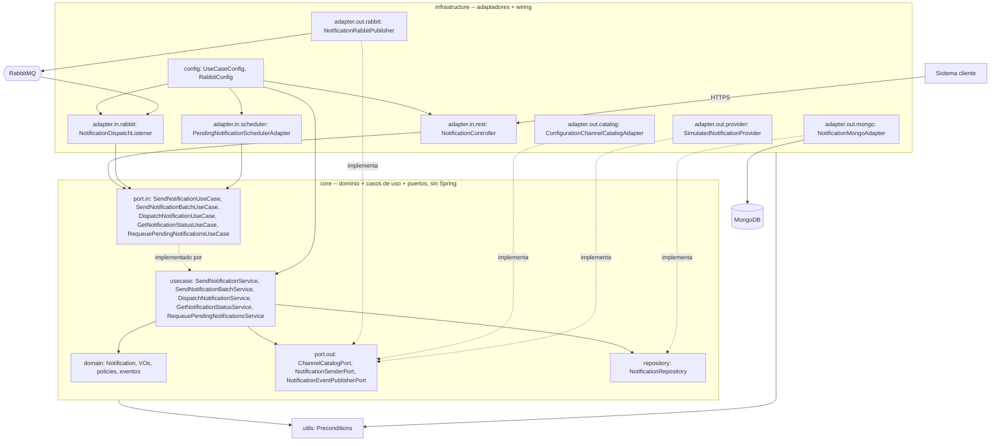

# 2. Componentes — arquitectura hexagonal

**Nota (2026-09-11):** actualizado respecto a la versión de Notion (2026-09-04) para incluir
`RequeuePendingNotificationsService`/`RequeuePendingNotificationsUseCase` y el adaptador
`adapter.in.scheduler` (HU2-030). Revisar el resto antes de darlo por vigente.
