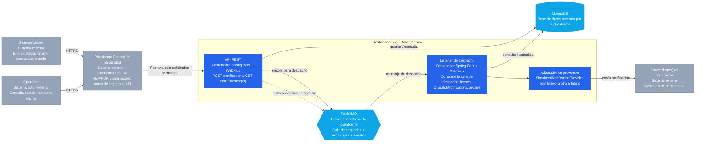

# 3. Contenedores (C4 Nivel 2) — mismo estilo que usó el equipo de Seguridad

**Nota (2026-09-11):** portado tal cual desde Notion (2026-09-04) — no incluye todavía el disparador
programado de HU2-030 como contenedor propio; revisar si amerita agregarse antes de darlo por
vigente.
