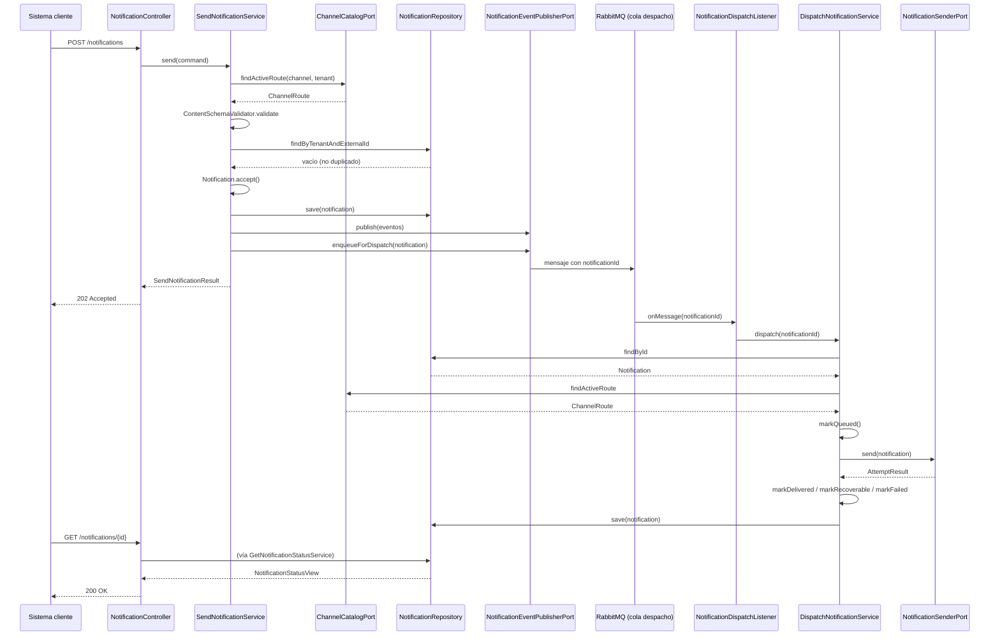

# 4. Secuencia — enviar y despachar una notificación

> **Obsoleto.** Este diagrama es la versión inicial y ya no coincide con el código (usa `markQueued()`,
> no tiene reserva atómica, ack manual, reintentos ni reencolado). La versión vigente es
> [`secuencias/F01-envio-y-despacho.drawio`](secuencias/F01-envio-y-despacho.drawio).

**Nota (2026-09-11):** portado tal cual desde Notion (2026-09-04) — no incluye el flujo de
reencolado automático (HU2-030). Revisar si vale la pena un diagrama de secuencia propio para ese
flujo antes de darlo por vigente.
