# 9. Paquetes — dependencias reales entre paquetes

Diagrama editable: [`09-paquetes.drawio`](09-paquetes.drawio) (2 páginas: vista general por capas, y detalle de los paquetes de `core`; la vista general agrupa los paquetes de `infrastructure` por función).

Calculado con los `import` de `src/main` de `origin/develop` a 2026-10-06 (commit `4e8248b`, con la spec 019 ya mergeada). No incluye la spec 020 (observabilidad), que sigue en su rama. Cada flecha del diagrama es un import real; el número entre paréntesis es la cantidad de imports.

## Reglas verificadas por pruebas
- `core` no depende de `infrastructure` (`HexagonalArchitectureTest`).
- `core` no depende de `org.springframework` (`HexagonalArchitectureTest`).
- `core.port..` no depende de `infrastructure.adapter..` (`HexagonalArchitectureTest`).
- Estructura modular verificada con Spring Modulith (`ModularityTests`).

## Hechos comprobados con los imports

- No hay ciclos entre paquetes (componentes fuertemente conexos calculados sobre el grafo completo).
- `core` solo usa `java.*`, `reactor-core`, `jackson` (5 clases, llega de forma transitiva) y `networknt json-schema-validator` (4 clases).
- `utils` solo usa `java.*`.
- Ningún adaptador de entrada importa `core.usecase`: entran por `core.port.in`. Solo `infrastructure.config` importa `core.usecase` (para crear los beans).
- `infrastructure.config` no importa ningún adaptador.

## Puntos a vigilar (no son violaciones de las reglas, pero conviene tenerlos presentes)

1. `core.repository` depende de `core.port.in` (`NotificationBatchRepository` usa `BatchAcceptedResult`), y `core.port.in` contiene tipos de resultado y vistas, no solo contratos de casos de uso.
2. `infrastructure.adapter.out.mongo` usa tipos de `core.port.in` (`BatchAcceptedResult`, `BatchItemOutcome`, `BatchItemResult`) y `infrastructure.adapter.out.provider` lee `core.port.in.ConfigurationView`: un adaptador de salida depende de un puerto de entrada.
3. `infrastructure.adapter.in.web` usa `core.port.out` directamente (`TokenValidationPort`, `SubscriptionTicketPort`), sin pasar por un caso de uso.
4. Dependencias entre adaptadores: `adapter.in.rabbit` importa `adapter.out.rabbit.AttachmentScanRequest`; `adapter.in.rest` importa `adapter.in.web.CorrelationIdWebFilter`; `adapter.out.security.local` y `.platform` importan `adapter.out.security.JwtFailures`.

## Vista general (Mermaid)

Misma vista que la página 1 del `.drawio`, en texto para GitHub o Notion. Las flechas van de quien depende hacia de quien depende (A --> B: A importa de B).

```mermaid
graph TB
    classDef entrada fill:#E1F5FE,stroke:#03A9F4,stroke-width:2px,color:#01579B;
    classDef nucleo fill:#E8F5E9,stroke:#4CAF50,stroke-width:2px,color:#1B5E20;
    classDef salida fill:#FFF3E0,stroke:#FF9800,stroke-width:2px,color:#E65100;
    classDef config fill:#ECEFF1,stroke:#607D8B,stroke-width:1px,color:#37474F;

    subgraph Entrada [Adaptadores de entrada]
        REST["API REST<br/><i>adapter.in.rest</i>"]
        RabbitIn["Listeners de mensajes<br/><i>adapter.in.rabbit</i>"]
        Sched["Planificadores<br/><i>adapter.in.scheduler</i>"]
        Web["Seguridad web<br/><i>adapter.in.web</i>"]
    end

    subgraph Core [Núcleo del negocio · core · sin Spring]
        PortIn["Puertos de entrada<br/><i>core.port.in</i>"]
        UC["Casos de uso<br/><i>core.usecase</i>"]
        PortOut["Puertos de salida<br/><i>core.port.out + core.repository</i>"]
        Model["Modelo de dominio<br/><i>core.domain.* y core.exception</i>"]
        CfgDin["Configuración dinámica<br/><i>core.domain.configuration</i>"]
    end

    subgraph Salida [Adaptadores de salida]
        Mongo["Persistencia MongoDB<br/><i>adapter.out.mongo</i>"]
        Prov["Proveedores de envío<br/><i>adapter.out.provider</i>"]
        RabbitOut["Mensajería de salida<br/><i>adapter.out.rabbit</i>"]
        Catalog["Catálogo de canales<br/><i>adapter.out.catalog</i>"]
        Params["Fuente de parámetros<br/><i>adapter.out.parameters</i>"]
        Jwt["Validación de tokens<br/><i>adapter.out.security.*</i>"]
        Storage["Almacenamiento<br/><i>adapter.out.storage</i>"]
        Av["Antivirus y detección<br/><i>adapter.out.antivirus + detection</i>"]
    end

    Spring["Configuración Spring<br/><i>infrastructure.config</i>"]
    Utils["utils<br/><i>módulo Maven</i>"]

    REST & RabbitIn & Sched -->|use| PortIn
    Web -->|use| PortOut
    UC -->|implement| PortIn
    UC -->|use| PortOut
    UC -->|use| Model
    UC -->|use| CfgDin
    Spring -->|use| UC
    Model --> Utils
    CfgDin --> Utils
    Mongo & Prov & RabbitOut & Catalog & Params & Jwt & Storage & Av ==>|implement| PortOut

    class REST,RabbitIn,Sched,Web entrada;
    class PortIn,UC,PortOut,Model,CfgDin nucleo;
    class Mongo,Prov,RabbitOut,Catalog,Params,Jwt,Storage,Av salida;
    class Spring,Utils config;
```

## Dependencias por paquete (imports de `src/main`)

| Paquete | Clases | Depende de |
|---|---|---|
| `core.domain` | 4 | `core.domain.event` (1), `core.domain.policy` (1), `core.domain.valueobject` (10), `core.exception` (1), `utils` (4) |
| `core.domain.configuration` | 17 | `utils` (7) |
| `core.domain.event` | 9 | `core.domain.valueobject` (16), `utils` (15) |
| `core.domain.policy` | 4 | `core.domain.valueobject` (5), `core.exception` (2), `utils` (2) |
| `core.domain.valueobject` | 27 | `utils` (19) |
| `core.exception` | 18 | `core.domain.valueobject` (10) |
| `core.port.in` | 44 | `core.domain` (5), `core.domain.configuration` (7), `core.domain.valueobject` (55), `utils` (22) |
| `core.port.out` | 17 | `core.domain` (2), `core.domain.configuration` (2), `core.domain.event` (1), `core.domain.valueobject` (16), `core.exception` (1), `utils` (4) |
| `core.repository` | 4 | `core.domain` (3), `core.domain.valueobject` (12), `core.port.in` (1), `utils` (1) |
| `core.usecase` | 23 | `core.domain` (14), `core.domain.configuration` (20), `core.domain.event` (3), `core.domain.policy` (8), `core.domain.valueobject` (39), `core.exception` (21), `core.port.in` (49), `core.port.out` (29), `core.repository` (15), `utils` (24) |
| `utils` | 6 | — |
| `infrastructure` | 1 | — |
| `infrastructure.adapter.in.rabbit` | 3 | `core.domain` (1), `core.domain.valueobject` (3), `core.exception` (2), `core.port.in` (3), `infrastructure.adapter.out.rabbit` (1), `infrastructure.config` (10), `utils` (11) |
| `infrastructure.adapter.in.rest` | 32 | `core.domain` (4), `core.domain.configuration` (1), `core.domain.valueobject` (28), `core.exception` (12), `core.port.in` (38), `infrastructure.adapter.in.web` (1), `infrastructure.config` (9), `utils` (14) |
| `infrastructure.adapter.in.scheduler` | 4 | `core.domain.configuration` (1), `core.exception` (1), `core.port.in` (4), `infrastructure.config` (3), `utils` (10) |
| `infrastructure.adapter.in.web` | 5 | `core.domain.valueobject` (5), `core.exception` (1), `core.port.out` (2), `infrastructure.config` (2), `utils` (5) |
| `infrastructure.adapter.out.antivirus` | 2 | `core.domain.valueobject` (1), `core.exception` (1), `core.port.out` (1), `infrastructure.config` (1), `utils` (2) |
| `infrastructure.adapter.out.catalog` | 5 | `core.domain.valueobject` (4), `core.port.out` (4), `infrastructure.config` (1), `utils` (4) |
| `infrastructure.adapter.out.detection` | 1 | `core.domain.valueobject` (1), `core.port.out` (1), `utils` (1) |
| `infrastructure.adapter.out.mongo` | 17 | `core.domain` (4), `core.domain.configuration` (4), `core.domain.valueobject` (40), `core.exception` (2), `core.port.in` (4), `core.port.out` (3), `core.repository` (4), `infrastructure.config` (1), `utils` (7) |
| `infrastructure.adapter.out.parameters` | 3 | `core.domain.configuration` (2), `core.exception` (1), `core.port.out` (3), `infrastructure.config` (1), `utils` (1) |
| `infrastructure.adapter.out.provider` | 17 | `core.domain` (5), `core.domain.configuration` (1), `core.domain.valueobject` (18), `core.exception` (4), `core.port.in` (4), `core.port.out` (5), `infrastructure.config` (8), `utils` (10) |
| `infrastructure.adapter.out.rabbit` | 4 | `core.domain` (1), `core.domain.event` (4), `core.domain.valueobject` (3), `core.port.out` (3), `infrastructure.config` (8), `utils` (7) |
| `infrastructure.adapter.out.security` | 1 | `core.exception` (1) |
| `infrastructure.adapter.out.security.local` | 2 | `core.domain.valueobject` (5), `core.exception` (1), `core.port.out` (1), `infrastructure.adapter.out.security` (1), `infrastructure.config` (1) |
| `infrastructure.adapter.out.security.platform` | 1 | `core.domain.valueobject` (3), `core.exception` (1), `core.port.out` (1), `infrastructure.adapter.out.security` (1), `infrastructure.config` (1) |
| `infrastructure.adapter.out.storage` | 2 | `core.domain` (1), `core.exception` (2), `core.port.out` (3), `infrastructure.config` (2), `utils` (3) |
| `infrastructure.config` | 30 | `core.domain` (1), `core.domain.configuration` (10), `core.domain.event` (1), `core.domain.policy` (1), `core.port.in` (3), `core.port.out` (13), `core.repository` (3), `core.usecase` (2), `utils` (10) |

## Dependencias externas por paquete de `infrastructure`

| Paquete | Librería |
|---|---|
| `adapter.in.rest` | Spring Web (`org.springframework.web.bind`) |
| `adapter.in.web` | Spring WebFlux |
| `adapter.in.rabbit`, `adapter.out.rabbit`, `config` | Spring AMQP (y `com.rabbitmq` en el listener) |
| `adapter.in.scheduler` | Spring Scheduling |
| `adapter.out.mongo`, `adapter.out.catalog` | Spring Data MongoDB reactivo |
| `adapter.out.provider`, `adapter.out.parameters` | Spring WebFlux (`WebClient`) |
| `adapter.out.security` (y `local`, `platform`) | jjwt |
| `adapter.out.storage` | MinIO y Spring Boot Actuator |
| `adapter.out.antivirus` | Spring Boot Actuator |
| `adapter.out.detection` | Apache Tika |
| `config` | Azure Key Vault (`com.azure`), Micrometer |
